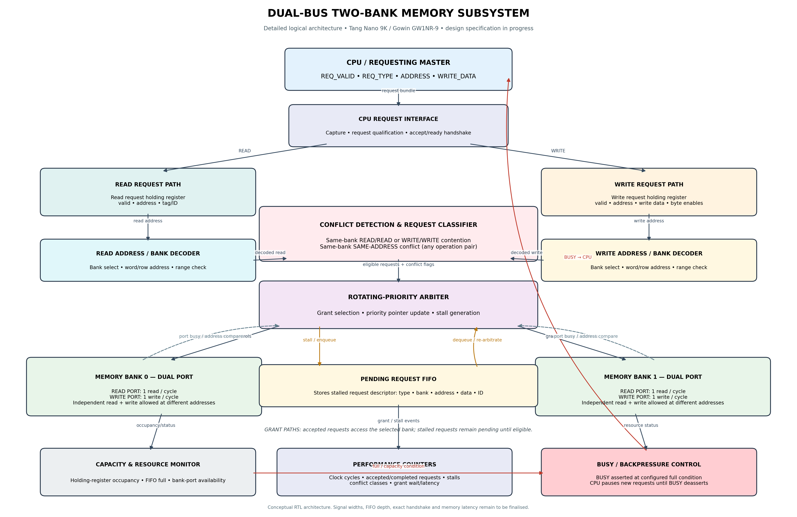

# Analysis and Optimisation of Memory Bank Conflicts in a Dual-Bus Architecture on FPGA

A two-bank memory subsystem with separate read and write paths, dual-port bank behaviour, rotating-priority arbitration, FIFO-based pending-request retention and CPU backpressure.

**Target:** Sipeed Tang Nano 9K (Gowin GW1NR-9)  
**Status:** Work in Progress

## Detailed architecture

See [Detailed Architectural Specification](docs/architecture.md) for port behaviour, conflict rules, arbitration, FIFO handling, BUSY protocol, instrumentation and verification scenarios.

## Defined behaviour
- Each bank supports one read and one write operation per cycle.
- Same-bank read/read requests contend for the read port.
- Same-bank write/write requests contend for the write port.
- Any two requests to the same address in the same bank conflict.
- Read and write to different addresses in the same bank may proceed concurrently.
- Rotating-priority arbitration selects the winner.
- The losing request is retained in pending FIFO storage.
- BUSY applies CPU backpressure when request capacity is full.

Widths, FIFO topology/depth, handshake timing and memory latency remain to be finalised in the RTL specification.

## Project Status

🚧 Work in Progress

RTL development, simulation, FPGA implementation and performance optimisation are ongoing.
